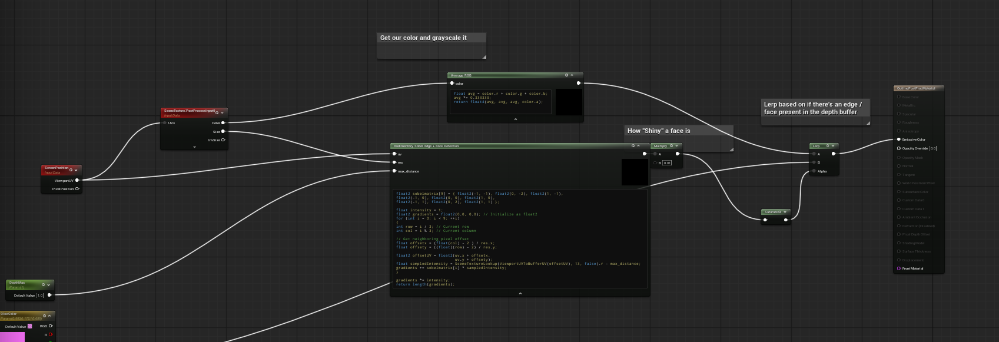

# HiLite - Item Highlight

Here's the base documentation of the HiLite program!

## Necessary Setup

In order to use this plugin, you will need to enable Custom Depth. Optionally, for more control, you can also add a Custom Stencil and write your own material.

## Materials (in HiLite/Materials folder):

Contains a material that highlights faces and creates an outline for objects, named OutlinePostProcMaterial. An example instance, with some uniforms edited, is named OutlinePostProcMaterial_inst.

The material samples the custom depth buffer, finds edges and highlights near faces, and colors them based on an input GlowColor. All colors are also converted into grayscale.


Here's the algorithm to detect edges and faces in the custom depth buffer:

```
// hlsl
// inputs:
// uv: uv space
// max_distance: the max distance (helps for face detection)
// res: size of scene tex
float2 sobelmatrix[9] = { float2(-1, -1), float2(0, -2), float2(1, -1),
float2(-1, 0), float2(0, 0), float2(1, 0),
float2(-1, 1), float2(0, 2), float2(1, 1) };

float intensity = 1;
float2 gradients = float2(0.0, 0.0); // Initialize as float2
for (int i = 0; i < 9; ++i)
{
int row = i / 3; // Current row
int col = i % 3; // Current column

// Get neighboring pixel offset
float offsetx = (float(col) - 2 ) / res.x;
float offsety = ((float)(row) - 2) / res.y;

float2 offsetUV = float2(uv.x + offsetx,
                         uv.y + offsety);
float sampledIntensity = SceneTextureLookup(ViewportUVToBufferUV(offsetUV), 13, false).r - max_distance;
gradients += sobelmatrix[i] * sampledIntensity;
}

gradients *= intensity;
return length(gradients);
```

## Blueprints (in HiLite/Blueprints folder):

There is an additional blueprint that can be used to toggle enhanced vision, named ToggleVisionComponent.

### Variables

#### m_bVisionEnabled -> bool

Whether the enhanced vision is enabled.

### Functions

#### InitializeVision(Params: Camera -> Camera Object Reference)

Sets the camera's post process blend weight to zero and sets m_bVisionEnabled to false.

#### ToggleVision(Params: Camera -> Camera Object Reference)

Toggles m_bVisionEnabled and then sets the post process blend weight of the camera to 1 if true and 0 if false.
